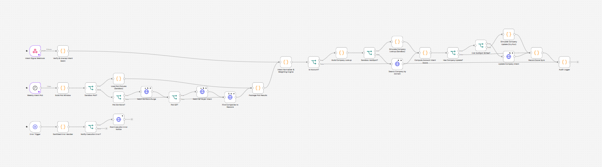
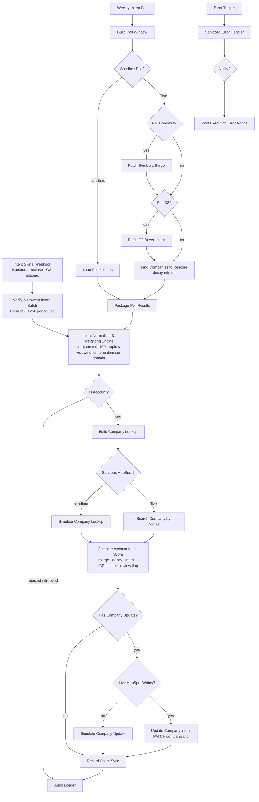

# n8n-multisource-intent-data-account-scorer

**Bombora, 6sense and G2 buyer-intent signals → one normalized score per source → recency decay and ICP fit → a composite account intent score, tier and review flag on every HubSpot company.**

I built this n8n workflow for revenue teams paying for more than one intent provider who still can't answer a simple question: *which accounts are actually in market, and do they fit our ICP?* Bombora says "surging on Revenue Operations", 6sense says "Decision stage", and G2 shows a competitor-pricing page view. Each lives in its own field with its own scale. This engine puts them on one 0–100 scale, decays old signals, corroborates across providers, weighs the result against ICP fit from HubSpot, and writes one transparent score per company.

> **Safe by default.** `SANDBOX_MODE=true` and `DRY_RUN=true`. Out of the box, the workflow only uses pinned fictional signals and companies. It makes no Bombora, 6sense, G2 or HubSpot calls until you turn both switches off.

Built by DH Robin, Revenue Infrastructure Architect · dhRobin Systems · MIT licensed.

---

## Table of Contents

1. [Why this exists](#1-why-this-exists)
2. [Architecture](#2-architecture)
3. [Repository layout](#3-repository-layout)
4. [Prerequisites](#4-prerequisites)
5. [Getting signals in](#5-getting-signals-in)
6. [Normalization & weighting](#6-normalization--weighting)
7. [Scoring logic](#7-scoring-logic)
8. [HubSpot company properties](#8-hubspot-company-properties)
9. [Environment variables](#9-environment-variables)
10. [Node configuration guide](#10-node-configuration-guide)
11. [Deployment steps & testing stages](#11-deployment-steps--testing-stages)
12. [Security & privacy model](#12-security--privacy-model)
13. [Troubleshooting](#13-troubleshooting)
14. [Known limitations](#14-known-limitations)
15. [Disclaimer & license](#15-disclaimer--license)

---

## 1. Why this exists

- **Every provider speaks a different language.** Bombora scores topics, 6sense assigns stages, and G2 reports page visits. Reps don't know which one to trust.
- **Intent without fit wastes time.** A 40-person retailer surging on your category isn't a priority if you sell to mid-market software companies.
- **Old intent looks like current intent.** A surge from six weeks ago still sits in the CRM field as if it were today.
- **Black-box scores don't get adopted.** If nobody can explain why an account is "hot", nobody acts on it.

My answer:
- One documented formula per provider.
- Decay by age, and a bonus when providers agree.
- An ICP fit score from HubSpot's own firmographics.
- A composite with its inputs written next to it, plus a review flag whenever an account moves up into **warm** or **hot**.

## 2. Architecture





| Stage | Nodes |
|---|---|
| Webhook triggers & poller | `Intent Signal Webhook`, `Verify & Unwrap Intent Batch`, `Weekly Intent Poll` → `Fetch Bombora Surge`, `Fetch G2 Buyer Intent`, `Find Companies to Rescore`, `Package Poll Results` |
| Intent normalizer / weighting engine | `Intent Normalizer & Weighting Engine` |
| Scoring logic | `Compute Account Intent Score` |
| HubSpot Companies sync | `Build Company Lookup`, `Search Company by Domain`, `Update Company Intent`, `Record Score Sync` (sandbox and dry run: the simulators) |
| Audit & errors | `Audit Logger`, `Sanitized Error Handler` |

**Design choice: HubSpot is the state store.** Signals from different providers arrive at different times. Instead of a separate database, each provider's latest normalized score and date are stored on the company. Each run merges new signals with what's there, then recomputes the composite. Re-running is safe: the same inputs give the same score.

## 3. Repository layout

```
n8n-multisource-intent-data-account-scorer/
├── README.md        ← this file
├── workflow.json    ← import into n8n (inactive, sandbox defaults, pinned fixtures)
├── DISCLAIMER.md
└── LICENSE          ← MIT
```

All logic lives in Code nodes inside `workflow.json`. There are no community nodes and no stored n8n credentials. Every secret comes from an environment variable.

## 4. Prerequisites

| Item | Notes |
|---|---|
| n8n | 1.x, with `N8N_BLOCK_ENV_ACCESS_IN_NODE=false` and `NODE_FUNCTION_ALLOW_BUILTIN=crypto` |
| HubSpot | Private app token with `crm.objects.companies.read` and `crm.objects.companies.write`; the custom company properties in section 8 |
| Bombora | Company Surge access via the API (a report whose JSON results URL you can fetch) or a delivery you forward to the webhook |
| 6sense | Account-level intent score and buying stage forwarded to the webhook (from a 6sense workflow, CRM sync job or relay) |
| G2 | Buyer Intent API token (for the weekly poll) and/or G2 webhook deliveries forwarded to the webhook |
| Workflow settings | Concurrency of 1 (scores are read, then written); Settings → Error Workflow = this workflow |

You don't need all three providers. Any one source produces a score, and more sources raise confidence through corroboration.

## 5. Getting signals in

### 5.1 Webhook (all providers)

`POST https://YOUR_N8N_HOST/webhook/intent-scorer/signals`

```json
{
  "source": "bombora",
  "sent_at": "2026-11-16T06:00:00Z",
  "signals": [
    { "domain": "northwind-fixture.example", "topic_name": "Revenue Operations", "composite_score": 82, "composite_score_delta": 12, "week": "2026-11-09" }
  ]
}
```

**Signing:**
- `X-Intent-Timestamp: <unix seconds>`
- `X-Intent-Signature: sha256=<hex HMAC-SHA256(secret, X-Intent-Timestamp + "." + raw body)>`
- The secret comes from `INTENT_WEBHOOK_SECRET_<SOURCE>` (`_BOMBORA`, `_6SENSE`, `_G2`), falling back to `INTENT_WEBHOOK_SECRET`.
- Outside sandbox, timestamps older than `SIGNATURE_TOLERANCE_SECONDS` (300) are rejected.

Providers deliver intent in different ways (report APIs, files, CRM syncs, workflow webhooks). Put a small relay, or an n8n sub-workflow, in front that wraps the provider's records in this envelope and signs it. Don't weaken the check.

| `source` | Record fields read (others ignored) |
|---|---|
| `bombora` | `domain`, `topic_name`, `composite_score` (0–100), `composite_score_delta`, `week` |
| `6sense` (or `sixsense`) | `domain`, `intent_score` (0–100), `buying_stage` (Target, Awareness, Consideration, Decision, Purchase), `profile_fit`, `keywords`, `updated_at` |
| `g2` | `company_domain`, `visit_type` (profile, category, compare, competitors, alternatives, pricing, competitive/pricing, …), `visits`, `visit_date`, `product_name` |

Up to `MAX_SIGNALS_PER_BATCH` (5,000) records per request.

### 5.2 Weekly poll

**Weekly Intent Poll** runs on Mondays at 06:00 UTC. That fits Bombora's weekly refresh.

- **Bombora:** `GET BOMBORA_SURGE_RESULTS_URL`, the JSON results of a Company Surge report you create in Bombora (for example with a score threshold of 60). The auth header is configurable (`BOMBORA_AUTH_HEADER_NAME`, `BOMBORA_AUTH_SCHEME`, `BOMBORA_API_KEY`), so it matches your Bombora API agreement. Leave the URL empty to rely on the webhook.
- **G2:** `GET {G2_API_BASE_URL}/api/v2/buyer_intent?start_date=…&end_date=…` with `Authorization: Token token=G2_API_TOKEN`. JSON:API `data[].attributes` are unwrapped. Check the query parameters against your G2 API documentation.
- **Rescore:** HubSpot search for companies with an account score whose `intent_last_scored` is older than `RESCORE_AFTER_DAYS` (6). They're recomputed, so decay pulls stale scores down even without new signals.

The cursor advances only in live mode, and only when every enabled call succeeded.

## 6. Normalization & weighting

Each provider is converted to **one 0–100 score per account**, before decay:

| Source | Formula |
|---|---|
| **Bombora** | Only topics with composite score ≥ `BOMBORA_SURGE_THRESHOLD` (60) count. Score = best (topic score × topic weight) + breadth bonus of 4 per additional surging topic with weight ≥ 0.5 (max +12), capped at 100. Top 5 surging topics are stored. |
| **6sense** | 0.6 × intent score + 0.4 × buying-stage score (Target 10 · Awareness 30 · Consideration 55 · Decision 80 · Purchase 95). |
| **G2** | Sum of the 4 strongest visit records: 30 × visit-type weight × (1 + ln(visits)), capped at 100. Competitor views (`competitive/*`, `competitors`, `alternatives`) set `intent_g2_competitor_research`. |

**Topic weights** (`TOPIC_WEIGHTS_JSON`) say how close a Bombora topic is to what you sell: `{"Revenue Operations": 1.0, "Sales Forecasting": 0.9, "CRM Software": 0.8, "Data Warehousing": 0.5}`. Unlisted topics get `DEFAULT_TOPIC_WEIGHT` (0.3), so an unrelated surge such as "Employee Benefits" barely moves the score.

**G2 visit weights** (`G2_VISIT_WEIGHTS_JSON`), defaults:

| Visit type | Weight |
|---|---|
| pricing, competitive/pricing | 1.0 |
| compare, competitive/compare | 0.9 |
| competitors, alternatives | 0.85 |
| competitive/profile | 0.7 |
| profile | 0.6 |
| product_reference_page, reviewers | 0.5 |
| category, vendors | 0.4 |
| licensed_content, ad | 0.3 |

**Dropped before scoring:** invalid domains and free-mail domains (gmail.com, outlook.com, …). `www.` and paths are stripped. Person-level fields (visitor location, contacts) are never read.

## 7. Scoring logic

**1 · Merge.** New source scores replace the stored ones for that source. An update older than the stored date for that source is ignored (`<source>_update_older_than_stored`).

**2 · Decay.** `effective = score × 0.5^(age in days ÷ INTENT_HALF_LIFE_DAYS)`, with a half-life of 14 days. Sources older than `MAX_SIGNAL_AGE_DAYS` (45) are inactive.

**3 · Composite intent (0–100):**
```
intent = 0.6 × max(effective_s × trust_s) + 0.4 × Σ(effective_s × trust_s) ÷ Σ trust_s   (active sources)
       + 5 for each additional source with effective ≥ 40 (max +10), capped at 100
```
Trust defaults (`INTENT_SOURCE_WEIGHTS_JSON`): 6sense 1.0 · G2 0.9 · Bombora 0.85.

**4 · ICP fit (0–100)** from HubSpot company properties (`ICP_RULES_JSON`):

| Rule | Default | Points |
|---|---|---|
| `industry` in list | COMPUTER_SOFTWARE, FINANCIAL_SERVICES, LOGISTICS_AND_SUPPLY_CHAIN, INFORMATION_TECHNOLOGY_AND_SERVICES | 35 |
| `numberofemployees` in range | 200–5,000 | 30 |
| `country` in list | United States, Canada, United Kingdom, Germany | 20 |
| `annualrevenue` in range | 20M–1B | 15 |

A missing value earns half the points and is flagged (`revenue_missing`, …), so incomplete records aren't treated as bad fits.

**5 · Account score and tier:**
```
account = INTENT_WEIGHT (0.6) × intent + (1 − INTENT_WEIGHT) × fit
```

| Tier | Rule |
|---|---|
| `non_icp` | fit < `NON_ICP_FIT_MAX` (35) and intent ≥ 40. In-market, but not your customer. |
| `hot` | account ≥ `HOT_SCORE_MIN` (75), intent ≥ `HOT_INTENT_MIN` (60) and fit ≥ `HOT_FIT_MIN` (50) |
| `warm` | account ≥ `WARM_SCORE_MIN` (55) |
| `monitor` | account ≥ `MONITOR_SCORE_MIN` (35) |
| `cold` | otherwise |

**6 · Trend and review:**
- **Trend:** compares with the previous account score: `rising` (≥ +8), `falling` (≤ −8), `steady`, or `new`.
- **Review flag:** moving **up** into warm or hot sets `intent_review_required = true`, with a reason such as "Moved from monitor to hot (score 80, intent 67, fit 100): Bombora surge on Revenue Operations (82); 6sense Decision stage (intent 78)". The workflow never clears the flag; a person does, after reviewing.
- **History:** `intent_score_history` keeps the last `SCORE_HISTORY_SIZE` (12) runs, one per day.

**Holds** (shown in the audit log, no write):
- `company_not_found`: domain not in HubSpot. Companies are never created.
- `duplicate_companies_for_domain`: the oldest record is used and flagged.
- `lookup_failed`.

## 8. HubSpot company properties

Create these in a "Buyer intent" group. The prefix is configurable with `INTENT_PROPERTY_PREFIX` (default `intent_`).

| Property | Type | Written |
|---|---|---|
| `intent_bombora_score` / `intent_bombora_date` / `intent_bombora_topics` | Number / Date / Single-line text | latest Bombora source score, week, top surging topics |
| `intent_6sense_score` / `intent_6sense_date` / `intent_6sense_stage` | Number / Date / Single-line text | latest 6sense source score, date, buying stage |
| `intent_g2_score` / `intent_g2_date` / `intent_g2_activity` / `intent_g2_competitor_research` | Number / Date / Single-line text / Single checkbox | latest G2 source score, date, visit summary, competitor research flag |
| `intent_score` | Number | composite intent (decayed) |
| `intent_fit_score` | Number | ICP fit |
| `intent_account_score` | Number | composite account score |
| `intent_tier` | Dropdown: `hot`, `warm`, `monitor`, `cold`, `non_icp` | tier |
| `intent_trend` | Dropdown: `rising`, `steady`, `falling`, `new` | vs previous score |
| `intent_sources_active` | Number | sources with non-zero effective score |
| `intent_top_signal` | Single-line text | strongest new signals this run |
| `intent_review_required` / `intent_review_reason` | Single checkbox / Multi-line text | set on upward moves into warm/hot |
| `intent_last_scored` | Date | last run date (drives weekly rescoring) |
| `intent_score_history` | Multi-line text | JSON of recent runs `{d, s, i, f, t}` |

Industry values must match HubSpot's internal values (for example `COMPUTER_SOFTWARE`).

## 9. Environment variables

Copy this block into your n8n environment and replace every placeholder.

```bash
# ── Safety switches (both must be "false" before anything is written) ──
SANDBOX_MODE=true
DRY_RUN=true

# ── Webhook signing (per source, or one shared secret) ──
INTENT_WEBHOOK_SECRET=YOUR_INTENT_WEBHOOK_SECRET
INTENT_WEBHOOK_SECRET_BOMBORA=
INTENT_WEBHOOK_SECRET_6SENSE=
INTENT_WEBHOOK_SECRET_G2=
SIGNATURE_TOLERANCE_SECONDS=300
MAX_SIGNALS_PER_BATCH=5000

# ── Bombora (weekly poll; leave the URL empty to use the webhook only) ──
BOMBORA_API_KEY=YOUR_BOMBORA_API_KEY
BOMBORA_SURGE_RESULTS_URL=
BOMBORA_AUTH_HEADER_NAME=Authorization
BOMBORA_AUTH_SCHEME=Bearer
BOMBORA_SURGE_THRESHOLD=60
POLL_BOMBORA=true

# ── 6sense (webhook) ──
SIXSENSE_API_KEY=YOUR_6SENSE_API_KEY

# ── G2 (weekly poll) ──
G2_API_TOKEN=YOUR_G2_API_TOKEN
G2_API_BASE_URL=https://data.g2.com
G2_PAGE_SIZE=100
POLL_G2=true

# ── HubSpot ──
HUBSPOT_ACCESS_TOKEN=YOUR_HUBSPOT_ACCESS_TOKEN
HUBSPOT_API_BASE_URL=https://api.hubapi.com
INTENT_PROPERTY_PREFIX=intent_
ICP_EXTRA_PROPERTIES=

# ── Weighting & scoring (one line of JSON each; empty = defaults in sections 6–7) ──
TOPIC_WEIGHTS_JSON={"Revenue Operations":1.0,"Sales Forecasting":0.9}
DEFAULT_TOPIC_WEIGHT=0.3
G2_VISIT_WEIGHTS_JSON=
INTENT_SOURCE_WEIGHTS_JSON=
ICP_RULES_JSON=
INTENT_HALF_LIFE_DAYS=14
MAX_SIGNAL_AGE_DAYS=45
INTENT_WEIGHT=0.6
HOT_SCORE_MIN=75
HOT_INTENT_MIN=60
HOT_FIT_MIN=50
WARM_SCORE_MIN=55
MONITOR_SCORE_MIN=35
NON_ICP_FIT_MAX=35
SCORE_HISTORY_SIZE=12

# ── Weekly poll ──
POLL_LOOKBACK_DAYS=7
RESCORE_AFTER_DAYS=6

# ── Error notices (optional) ──
SLACK_WEBHOOK_URL=YOUR_SLACK_WEBHOOK_URL
SLACK_NOTIFY_ON_MONITOR_ERROR=true

# ── Audit ──
DOMAIN_REF_SALT=YOUR_RANDOM_SALT
AUDIT_LOG_TO_STDOUT=true
AUDIT_RING_BUFFER_SIZE=500

# ── n8n platform ──
N8N_BLOCK_ENV_ACCESS_IN_NODE=false
NODE_FUNCTION_ALLOW_BUILTIN=crypto
```

Flags accept only `true/1/yes/on` or `false/0/no/off`. Anything else keeps the safe default. Invalid JSON overrides fall back to the defaults. Keep comments on their own lines. `SIXSENSE_API_KEY` is only needed if you extend the workflow to call 6sense directly; by default 6sense data arrives by webhook.

## 10. Node configuration guide

| Node | Type | Key settings |
|---|---|---|
| Intent Signal Webhook | Webhook v2 | POST `intent-scorer/signals` · Respond immediately · **Raw Body on** |
| Weekly Intent Poll | Schedule Trigger v1.2 | weekly, Monday 06:00 UTC |
| Verify & Unwrap Intent Batch | Code v2, all items | per-source HMAC, timestamp window, source allowlist |
| Fetch Bombora Surge | HTTP Request v4.2 | URL and auth header from env · execute once · full response · never error · 3 tries |
| Fetch G2 Buyer Intent | HTTP Request v4.2 | `Token token=` auth · execute once |
| Find Companies to Rescore | HTTP Request v4.2 | companies search on `intent_last_scored` · execute once |
| Intent Normalizer & Weighting Engine | Code v2, all items | section 6 |
| Search Company by Domain | HTTP Request v4.2 | companies search, `domain` EQ (with and without www) · batching 4 per 1.1 s (HubSpot search limits) |
| Compute Account Intent Score | Code v2, each item | section 7 |
| Update Company Intent | HTTP Request v4.2 | `PATCH /crm/v3/objects/companies/{id}` · batching 5 per 1.1 s · 3 tries |
| Record Score Sync / Audit Logger | Code v2, each item | results · `intentScorerAudit` ring buffer (not in sandbox) |
| Error Trigger → Sanitized Error Handler | Error Trigger v1 + Code v2 | redacted summary, optional Slack notice |

## 11. Deployment steps & testing stages

### Deployment steps

1. In n8n, go to **Workflows → Import from File** and select `workflow.json`. It imports **inactive**.
2. Set the environment variables (section 9) and restart n8n.
3. In HubSpot, create the private app (scopes in section 4) and the company properties (section 8).
4. Set **Settings → Error Workflow** to this workflow, and concurrency to 1.
5. Configure your relay(s) to sign and forward provider records to the webhook, and set the poll URLs and tokens.
6. Run the stages below, then activate the workflow.

### Stage 1 · Sandbox (pinned fixtures, no network)

`SANDBOX_MODE=true`, `DRY_RUN=true`. Execute **Intent Signal Webhook** (5 deliveries) and **Weekly Intent Poll**.

**Intent Signal Webhook**

| Account (fictional) | Inputs | Expected |
|---|---|---|
| Northwind (software, 850 staff, US) | Bombora RevOps 82 + Forecasting 74, 6sense Decision (78), older G2 40 | intent 67 · fit 100 · **80 hot** (was monitor) · review flag · trend rising |
| Contoso (financial services, UK) | G2 competitor-pricing ×3 + compare ×2, Bombora RevOps 61 | intent 76 · **86 hot** · competitor research flag |
| Harbor (logistics, 150 staff, revenue missing) | Bombora Data Warehousing 70, G2 category view | fit 63 (`revenue_missing`) · **37 monitor** |
| Globex (retail, 40 staff, Brazil) | 6sense Purchase (85) | fit 0 · **non_icp**: in market, outside your ICP |
| Initrode | 6sense signal | `company_not_found` (no company created) |
| — | free-mail domain in Bombora batch | dropped (`free_mail_domain`) |
| — | tampered G2 batch · unknown source | rejected `signature_mismatch` · `source_not_supported` |

**Weekly Intent Poll**

| Account | Inputs | Expected |
|---|---|---|
| Northwind | new Bombora week + G2 profile views | rescored, **77 hot** |
| Umbrella | rescore only (Bombora 75 from five weeks ago) | decay → intent 12 · **47 monitor** (was hot) · trend falling |

Open **Simulate Company Update (Dry Run)** to see every property that would be written. All companies, domains (`*.example`), IDs, numbers and secrets are fictional.

### Stage 2 · Shadow (real APIs, writes simulated)

`SANDBOX_MODE=false`, `DRY_RUN=true`. Send real batches and run the poll once. Compare tiers with your team's judgement on 20–30 known accounts, and tune `TOPIC_WEIGHTS_JSON`, `ICP_RULES_JSON` and the thresholds.

### Stage 3 · Live in a HubSpot sandbox

`DRY_RUN=false` in a HubSpot developer test account or sandbox. Confirm:
- properties are written;
- replays don't change scores;
- stale updates are ignored;
- the weekly rescore lowers old scores.

### Stage 4 · Production

Build HubSpot views or lists on `intent_tier` and `intent_review_required`. Review flagged accounts before routing them to sales.

## 12. Security & privacy model

- **No secrets in the workflow.** Provider and HubSpot credentials come from `$env`. The JSON holds placeholders and one fictional sandbox signing secret, used only while `SANDBOX_MODE=true`.
- **Fails closed.** Every webhook batch needs a valid per-source HMAC and a fresh timestamp. Unknown sources are rejected.
- **Account level only.** The engine reads company domains and account-level scores. It never reads, stores or creates contacts, and ignores visitor locations and person fields in provider payloads.
- **No record creation.** Companies are only matched by domain; unmatched domains are logged and skipped.
- **Redacted logs.** Audit records hold a salted **domain hash**, the HubSpot company id, sources, scores, tier and write results. No domains, no raw payloads. Keys matching `authorization|token|secret|password|api key|cookie|signature|webhook url` are replaced. HubSpot `pat-…`, G2 `Token token=…`, Bearer/Basic credentials, JWTs, private keys and Slack webhook URLs are scrubbed from every string.
- **Sanitized errors.** The error branch drops stack traces, request options and bodies.
- **Restrict n8n execution data.** Executions contain raw provider batches. Limit access and set a short retention period.

## 13. Troubleshooting

| Symptom | Likely cause | Fix |
|---|---|---|
| `signature_mismatch` | Wrong per-source secret, or the body was re-serialised | Match `INTENT_WEBHOOK_SECRET_<SOURCE>`; keep **Raw Body** on; sign `timestamp + "." + raw body` |
| `source_not_supported` | `source` isn't `bombora`, `6sense` or `g2` | Fix the relay envelope |
| Many `company_not_found` | Domains differ from HubSpot's (subsidiaries, regional domains) | Normalise domains in the relay, or add the domain to the HubSpot company |
| `bombora_poll_failed` | Results URL expired, or the auth header differs | Regenerate the report URL; set `BOMBORA_AUTH_HEADER_NAME` / `BOMBORA_AUTH_SCHEME` |
| `g2_poll_failed` (401) | Token or header format | Use `Authorization: Token token=…`; check the G2 API version and parameters |
| HubSpot 400 `VALIDATION_ERROR` | Missing properties or wrong dropdown options | Create the properties and options in section 8 |
| Unrelated topics inflate scores | Topic weights not set | Add your topics to `TOPIC_WEIGHTS_JSON` |
| Scores never fall | Rescore search failing, or `intent_last_scored` missing | Check **Find Companies to Rescore**; make sure the property exists |
| Everything is `non_icp` | Industry values don't match HubSpot's internal names | Use internal values such as `COMPUTER_SOFTWARE` in `ICP_RULES_JSON` |

## 14. Known limitations

- **The model is a heuristic.** Weights, half-life and thresholds are defaults to tune against your own win data, not a statistically fitted model.
- **Domain matching only.** Accounts are matched on the primary `domain` property.
- **Provider formats change.** Field names follow the providers' documented exports. Check one real record from each provider in Stage 2.
- **One G2 page per poll.** Raise `G2_PAGE_SIZE` or poll more often for high volumes.
- **Read-then-write.** Keep concurrency at 1.

---

## 15. Disclaimer & license

### ⚠️ Disclaimer & Liability Limitation

Use at your own risk. The code, workflows, and scripts in this repository (n8n-multisource-intent-data-account-scorer) are provided for educational and architectural demonstration purposes.

* **No Liability:** The author and dhRobin Systems accept no responsibility or liability for any direct, indirect, incidental, or consequential damages that result from using, misusing, or deploying these scripts.
* **No Warranty:** All software, n8n JSON blueprints, JavaScript modules and prompts are provided "AS IS", without warranty of any kind, express or implied. This includes, but is not limited to, warranties of merchantability, fitness for a particular purpose, and non-infringement.
* **Production Testing Required:** Always test thoroughly in an isolated staging environment, such as a HubSpot developer test account or sandbox, with `SANDBOX_MODE=true` and `DRY_RUN=true` enabled, before you connect live HubSpot or intent provider credentials. Treat every generated intent score or segment flag as a draft that a person must review before it's published or acted upon.
* **Third-Party APIs & Compliance:** You alone are responsible for complying with the terms of service, rate limits, data privacy regulations (GDPR/CCPA), and security policies of HubSpot, Bombora, 6sense, G2 and any connected services. That includes verifying lawful basis for tracking account intent, keeping personal data out of analytics logs, and reviewing every automatically created or updated CRM record.

The full disclaimer is also available in [DISCLAIMER.md](https://github.com/dhrobinsystems/n8n-multisource-intent-data-account-scorer/blob/main/DISCLAIMER.md).

### License

Released under the MIT License. Copyright (c) 2026 DH Robin (dhRobin Systems). See [LICENSE](https://github.com/dhrobinsystems/n8n-multisource-intent-data-account-scorer/blob/main/LICENSE).

---

Full text: DISCLAIMER.md · Licensed under the MIT License. License: MIT © 2026 DH Robin (dhRobin Systems) · Provided as-is, see the disclaimer.
